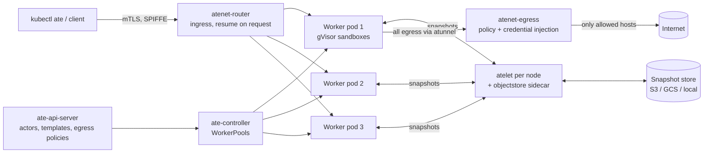

# agent-substrate-lab

**Run thousands of stateful, untrusted agents on a few pods with CNCF Agent Substrate, and measure
whether it keeps its promises.**

Agent Substrate (Google, donated to the CNCF Sandbox in November 2026, v1.0.0) maps many *actors*
(stateful agents) onto a small pool of warm *workers*. Idle actors are snapshotted out of memory and
restored when a request arrives. Every actor runs in gVisor (or a microVM), gets a SPIFFE identity,
starts with no egress, and never holds credentials. This repo tests those claims on your own cluster.

1. **memory-agent**: a small Go actor with RAM memory plus a notes file on a durable volume, an egress
   probe and a self-check. If both counters keep counting after a resume, Substrate restored the same
   process, not a reboot.
2. **sublab**: a harness that drives `kubectl ate` and runs 8 checks with a pass/fail gate.
3. **Two targets**: POC on kind (from the pinned v1.0.0 source, as upstream CI does) and an
   experimental EKS pilot (Terraform, S3 snapshots through Pod Identity, published release images).

Bible (visual walkthrough, end-to-end architecture diagram, checks, run commands): [`site/index.html`](site/index.html), deployed on Vercel from this repo and also a tab in the Study Bible.

## The checks

| ID | Severity | What it proves |
|---|---|---|
| SUB-01 | critical | RAM + disk state survive suspend/resume, same process (boot id unchanged) |
| SUB-02 | high | suspended actors resume on demand; p50/p95 recorded against a budget |
| SUB-03 | critical | 12 actors share 3 workers (4:1) and none loses state |
| SUB-04 | critical | no egress policy = no egress |
| SUB-05 | critical | an EgressPolicy opens exactly the listed host (pypi.org) and nothing else |
| SUB-06 | critical | no service-account token, no secrets in the actor environment |
| SUB-07 | high | the actor sees a gVisor kernel, not the host kernel |
| SUB-08 | medium | a new actor starts from the template's golden snapshot and answers |

## Architecture



Twelve actors, three workers: most actors are snapshots in the store at any moment. A request to a
suspended actor makes the router pick a free worker, restore the snapshot and forward the request.

## Quick start (POC)

Needs Go 1.27+, Docker, kubectl, kind, Python 3.11+. About 20–30 minutes the first time (images are
built from source).

```bash
make install && make test   # Go agent tests + harness tests, no cluster
make poc                    # kind, Substrate v1.0.0, counter demo baseline, memory agent
make e2e                    # 8 checks -> evals/results/<date>-kind/summary.md
make poc-down
```

## Scorecard (honest)

| Dimension | Score | Evidence | What closes the gap |
|---|---|---|---|
| Agent workload | 10 | `app/memory-agent` with 5 Go tests (state, restart, egress, secret scan) | - |
| Harness + gate | 10 | `tests/unit/test_checks.py`: healthy model passes, each broken guarantee is caught | - |
| POC e2e on kind | 10 | 8/8 pass, gate PASS: [run 44691545841](https://github.com/sai337/agent-substrate-lab/actions/runs/44691545841) | - |
| EKS path | 6 | Terraform (S3 + Pod Identity), release images, `eks-e2e.yml` | EKS is not an upstream-tested target; one real run will need fixes |
| Docs | 9 | `docs/` | measured numbers in the blog draft |

Measured on kind in GitHub Actions (20 Nov 2026): resume p50 139 ms / p95 168 ms over 12 actors, suspend 180 ms, new actor to first answer 1.2 s, actor kernel `4.19.0-gvisor`, 4 actors per worker with no state lost. One run on a shared CI runner; not comparable to the vendor's GKE figure (<500 ms).

## Licence

Apache-2.0
