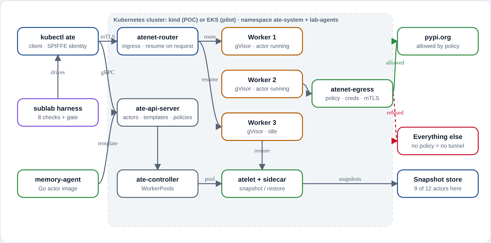
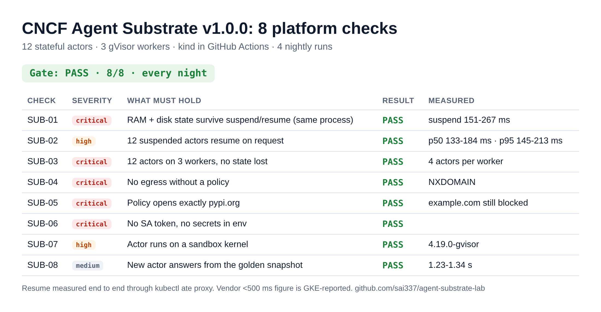

# 12 stateful AI agents, 3 pods, under 215 ms to wake up: testing CNCF Agent Substrate on my own cluster

Agents spend most of their life waiting: on a model, on a tool, on a person. If each agent holds a
pod while it waits, a thousand agents cost a thousand pods. Agent Substrate, which Google donated to
the CNCF Sandbox this month (v1.0.0), takes a different approach: snapshot idle agents out of memory
and restore them on any warm worker when a request arrives.

Vendor numbers are vendor numbers. I wanted to know whether it holds on my own cluster, for a
stateful agent I wrote, so I measured it.

**TL;DR**
- 12 stateful agents shared 3 worker pods (4:1) and **none lost state** across suspend and resume.
- Resume on request: **p50 133-184 ms, p95 145-213 ms** across four nightly runs on kind in GitHub Actions.
- Every agent ran on a **gVisor** kernel, had **no egress until a policy allowed it**, and the allow-list
  opened **exactly** the one host it named.
- My first run failed 4 of 8 checks. All four were my mistakes, and each one is a lesson for anyone
  building on this.
- Open source: https://github.com/sai337/agent-substrate-lab

## The model in one paragraph

An **actor** is a stateful workload, here one agent. A **WorkerPool** is a set of warm pods. An
**ActorTemplate** says what an actor runs; its first actor is captured as a **golden snapshot** that new
actors start from. When an actor goes idle it is **suspended**: with MEMORY fidelity, its process RAM,
root filesystem changes and durable volume go to a snapshot store and the worker is freed. A request to
a suspended actor goes through the **router**, which resumes it on any free worker. All egress leaves
through a shared **egress gateway** that applies the actor's policy; an actor with no policy has no tunnel at all.

## The agent I tested

A small Go "memory agent" with two counters: one in RAM, one in a file on the durable volume. It also has
an egress probe and a self-check that reports what an attacker inside would see (kernel, user, mounted
tokens, secret-looking environment variables). If both counters keep counting after a resume *and* the
process boot id is unchanged, Substrate restored the same process, not a fresh start.

## The 8 checks

| Check | What must hold |
|---|---|
| State | RAM and disk counts survive suspend/resume; same boot id |
| Resume | 12 suspended actors each wake on a request, within budget |
| Density | 12 actors on 3 workers, no state lost |
| Default egress | no policy, no internet |
| Allow-list | policy for pypi.org opens pypi.org and nothing else |
| Secrets | no service-account token, no secret-like env vars |
| Isolation | the actor sees a gVisor kernel, not the host's |
| Cold start | a new actor answers from the golden snapshot |

## Results (kind, GitHub Actions, 3 workers, 12 actors)

| Run | Resume p50 | Resume p95 | Suspend | New actor → first answer |
|---|---|---|---|---|
| 20 Nov | 139 ms | 168 ms | 180 ms | 1.24 s |
| 21 Nov | 179 ms | 190 ms | 210 ms | 1.34 s |
| 22 Nov | 134 ms | 145 ms | 151 ms | 1.23 s |
| 23 Nov | 184 ms | 213 ms | 267 ms | 1.31 s |

Resume is measured end to end through `kubectl ate proxy`, so it includes a local proxy hop. The actor
reported kernel `4.19.0-gvisor` every time. Shared CI runners are noisy; read the ranges, not one run.
The vendor's "<500 ms" figure is from GKE and not directly comparable, but on modest hardware these
numbers are comfortably inside it.

**On EKS:** _[update after the EKS run: same 8 checks on EKS 1.34 with S3 snapshots through Pod Identity;
p50/p95, suspend, cold start; note any fixes. EKS is not an upstream-tested target yet.]_

## Three mistakes my first run caught

**1. Idle has to mean suspended.** Half the resumes failed. My harness woke actors and left them running;
with 3 workers, the fourth had nowhere to go. Substrate behaves correctly here: density comes from agents
going idle. Design agents to suspend when their work is done. My unit tests now use a fake Substrate
that enforces worker capacity, so this cannot slip back in.

**2. A silent answer is not a pass.** My "no secrets" check passed even though the self-check request had
failed: an empty answer contained no secrets. Now a check without a real answer is an error.

**3. Policies take a few seconds.** The allow-list check failed with `no such host`. Denied names fail at
DNS (the actor's DNS relay answers NXDOMAIN), and a new policy reaches it in about 5 seconds; I waited 3.
The harness now polls before judging.

## What it means for platform teams

- **Snapshots contain memory.** Anything the agent fetched, including tokens and data, is in its snapshot.
  Encrypt the store, scope access to the two components that move snapshots, and never copy snapshots
  between environments. Promote templates, not snapshots.
- **HTTPS egress rules terminate TLS** at the gateway (that is what makes credential injection possible),
  so the actor must trust the gateway's CA through the trust bundle Substrate mounts.
- **Density is a design property of your agents**, not only of the platform.
- **Where it fits:** large fleets of mostly idle, stateful agents (one per user or per employee). Where
  every call needs per-program, per-method rules, I pair it with a per-agent policy proxy (see the
  OpenShell companion repo: https://github.com/sai337/openshell-eks-lab).

## What is next

The bigger goal is a promotion pipeline for agents: sandbox → staging → canary → production, where each
step needs evidence (evals, these runtime checks, a policy diff with named approval) and one policy file
compiles to both runtimes.

Code, the agent, the checks, CI and EKS Terraform: https://github.com/sai337/agent-substrate-lab
