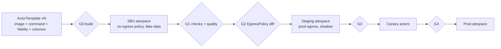

# Promotion: sbx → staging → canary → prod (Substrate view)

Same pipeline as openshell-eks-lab (see its PROMOTION.md for the full gate list); this page covers
what is specific to Agent Substrate, where agents are **stateful** and hibernate.



## What moves, and what never moves

| Moves between zones | Never moves |
|---|---|
| The ActorTemplate definition (image digest, command, snapshot fidelity, volumes) | **Snapshots.** A MEMORY snapshot holds process RAM: data and tokens from that zone |
| The EgressPolicy file, through G2 | Actor durable volumes from sbx |
| The eval set and thresholds | The golden snapshot (each zone builds its own from the template) |

Templates are immutable upstream: a new agent version is a new template. Prod actors are
repointed to the new template while suspended, then resumed.

## Gates in Substrate terms

| Gate | Substrate-specific check | Here today |
|---|---|---|
| G0 | template validates; image signed; agent unit tests | `go test`, `pytest` in `ci.yml` |
| G1 platform | the 8 checks: state survives hibernation, density, default-deny egress, allow-list exact, no secrets, gVisor kernel | `sublab run` (kind nightly, EKS on demand) |
| G1 quality | the agent's own golden set | planned: agent-promotion-lab |
| G2 | EgressPolicy diff: new hostnames, wildcards, all-ports, new rule types | `sublab policy-diff` |
| G3 / G4 | shadow replay; canary actors on the new template; resume p95 and error budget | planned |
| G5 | resume latency drift, snapshot failures, spend | nightly checks cover the runtime |

## Try G2

```bash
cat > /tmp/candidate.yaml <<'EOF'
rules:
  - https: {hostnames: ["pypi.org", "*.github.com"]}
EOF
sublab policy-diff k8s/egress-allow-pypi.yaml /tmp/candidate.yaml                        # G2 FAIL (wildcard)
sublab policy-diff k8s/egress-allow-pypi.yaml /tmp/candidate.yaml --approved-by owner    # G2 PASS
```

## When Substrate, when OpenShell

Substrate for large fleets of mostly idle, stateful agents (one per user or per employee), where
density and resume time matter most. OpenShell where each agent's calls need per-host, per-binary,
per-method rules. One `agent.yaml` policy compiles to both (planned compiler in agent-promotion-lab).
